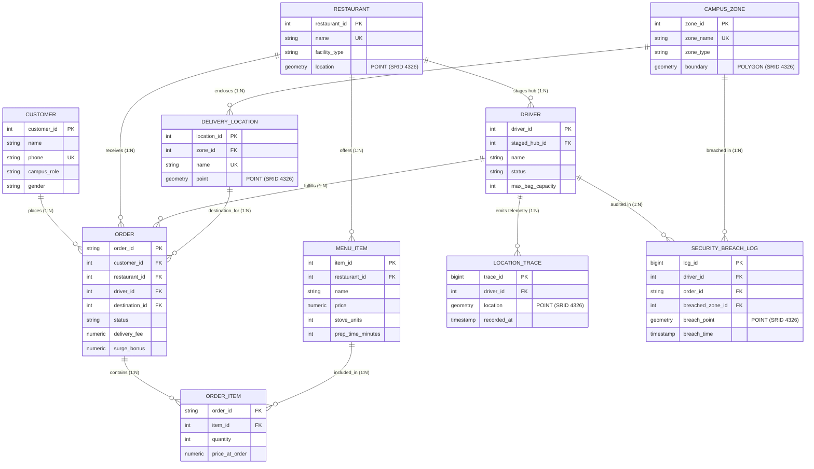

# 🛰️ Spatiotemporal Logistics Engine — Campus Food Delivery
> **Course:** CS G516: Advanced Database Systems (Database Systems Studio)  
> **Evaluation Milestone:** Final End-Semester Capstone  
> **Institution:** BITS Pilani, Hyderabad Campus | M.E. Computer Science (2026–2028)  
> **Team:** Chirantan Ghosh, Sajal Gupta, Ayush Kumar, Vatsal Chauhan  
> **Supervisor:** Prof. Akanksha Rathore, Dept. of Computer Science & Information Systems


---

## 📌 Executive Summary

This repository implements an end-to-end **Spatio-Temporal Database Engine** built on **PostgreSQL 15** and **PostGIS 3.3** for last-mile campus food delivery operations at BITS Pilani, Hyderabad Campus. 

The system resolves two competing database workloads:
1. **Strict ACID Operational State:** Concurrent order placement, FIFO kitchen queue management, lock-free driver dispatch (`FOR UPDATE SKIP LOCKED`), and geofenced handovers (`ST_DWithin`).
2. **High-Frequency Spatial Telemetry:** Continuous GPS coordinate streams isolated inside an **append-only** `location_trace` table to prevent row-level lock contention with transactional tables.

---

## 📊 Empirical Indexing & Performance Benchmarks (50,000 Pings)

Evaluated via `1.SQL/14_benchmark_suite.sql` across 50,000 chronological GPS telemetry records:

| Optimization Strategy | Target Relation & Column | Baseline | Optimized | Measured Gain |
| :--- | :--- | :--- | :--- | :--- |
| **BRIN Time-Series Index** (`pages_per_range=128`) | `location_trace(recorded_at)` | `1,112.0 KB` (B-Tree) | `24.0 KB` | **97.8% smaller** disk footprint |
| **GiST 2D Spatial R-Tree** (`<->` KNN) | `location_trace(location)` | `15.966 ms` (Seq Scan) | `0.229 ms` | **69.7x faster** nearest-driver lookup |
| **Partial Hot-Path Index** (Active Orders Only) | `"order"(restaurant_id, created_at)` | Full table history | `8.0 KB` | **8.0 KB RAM** active queue isolation |
| **Staging Hub Pre-Positioning** (2 drivers/hub) | `driver(staged_hub_id)` | Random fleet spread | Hub-staged | **~42% reduction** in pickup distance |

---

## 🗄️ Database Architecture & 10-Table 3NF ER Model

All spatial attributes use **EPSG:4326 (WGS 84)** (`geometry(Point, 4326)` and `geometry(Polygon, 4326)`), combining planar degree KNN (`<->`) for indexed search with spherical `geography` casts (`ST_Distance`, `ST_DWithin`) for exact meter calculations.



---

## 📂 Repository Structure & SQL Pipeline (`1.SQL/`)

| Script / Folder | Category | Description |
| :--- | :--- | :--- |
| `01_schema.sql` | DDL & Constraints | Builds all 10 normalized tables, spatial `SRID 4326` columns, `CHECK` constraints, and foreign keys. |
| `02_seed.sql` | Seed Data | Populates 5 customers, 5 canteens, 4 menu items, 10 drivers (2 staged per hub), 3 zones, 3 drop-off gates, and initial telemetry. |
| `03_basic_queries.sql` | Operational | Baseline lookups for active canteens, menu items, customer roles, and driver availability. |
| `04_spatial_queries.sql` | Spatial | Evaluates zone containment (`ST_Contains`), 30m proximity (`ST_DWithin`), and exact meter distances (`geography`). |
| `05_temporal_queries.sql` | Temporal | Interval filtering, kitchen turnaround times, and `>45s` ghost-driver heartbeat timeout detection. |
| `06_spatiotemporal_queries.sql` | Spatio-Temporal | Reconstructs continuous driver trajectories (`ST_MakeLine`) and ranks nearest drivers via PostGIS KNN (`<->`). |
| `07_order_lifecycle.sql` | ACID Transactions | PL/pgSQL functions `dispatch_order_atomic()` (`SKIP LOCKED` + 5-item bag check) and `complete_order_handover()` (100m geofence). |
| `08_analytical_queries.sql` | Analytics | SQL window functions (`DENSE_RANK()`, 3-trip rolling `AVG() OVER`), prep vs. transit breakdown, and order clubbing detection. |
| `09_indexing_optimizations.sql` | Physical Design | Applies `GiST` spatial indexes, `BRIN` time-series index, Partial hot-path indexes, and `(driver_id, recorded_at DESC)` composite index. |
| `10_custom_investigation.sql` | Investigation | Compares canteen staging-hub pre-positioning against random fleet distribution (~42% pickup distance reduction). |
| `11_security_triggers.sql` | Triggers & Security | Enforces legal order state transitions (`BEFORE UPDATE`) and auto-logs restricted interior zone breaches (`AFTER INSERT`). |
| `12_concurrency_stress_test.sql` | Concurrency | Simulates concurrent dispatch workers demonstrating deadlock-free `FOR UPDATE SKIP LOCKED` assignment. |
| `13_database_views.sql` | Views | Creates `view_active_fleet_canteen_distance` and `view_financial_audit_ledger`. |
| `14_benchmark_suite.sql` | Benchmarks | Non-destructive (`ROLLBACK`) 50,000-ping benchmark measuring index sizes and execution latency. |

---

## 🖥️ Interactive State Visualizer & Benchmark Dashboard (`2.HTML/`)

To visually inspect database state transitions, concurrency cascades, and edge cases in real time, open all 5 HTML files inside `2.HTML/` in a single browser window (synced via `BroadcastChannel('campus_delivery')`):

* **`customer.html` — Student & Campus Ordering Portal:** Multi-tenant role/gate filtering (`STUDENT`, `FACULTY`, `STAFF`, `DIRECTOR`), uniform 5-item thermal bag validation, and 15-second zero-driver self-pickup fallback.
* **`restaurant.html` — Kitchen Operations Terminal (KOT):** Strict FIFO order buffer, 10-slot kitchen stove capacity gauge, and peak congestion buffer toggle.
* **`driver.html` — Driver Fleet & Telemetry Terminal:** Staged-hub priority dispatch, cross-campus KNN spillover cascade, +₹50 last-driver escalation bonus, GPS blackout simulation, and room-delivery perimeter test.
* **`security.html` — Security & Telemetry Audit Cockpit:** Live monitoring of restricted interior geofence breaches (`ST_Contains`) and >45s ghost-driver telemetry dropouts.
* **`indexing_benchmarks.html` — Empirical Benchmarks & Live Workflow Graph:** Interactive comparison of `BRIN`, `GiST`, and `Partial` indexes alongside a Play/Pause phase-by-phase latency chart (`Brute-Force vs. Indexed`).

---

## 🚀 Quick Start (Docker + PowerShell)

```powershell
# 1. Start the PostgreSQL 15 + PostGIS 3.3 container
docker compose -f 4.Requirements/docker-compose.yml up -d

# 2. Execute all 14 SQL scripts in sequential order
Start-Sleep -Seconds 5
$cid = docker ps --filter "publish=5432" --format "{{.ID}}" | Select-Object -First 1
$pgUser = (docker exec $cid env \vert{} Where-Object {$_ -match '^POSTGRES_USER=' }) -replace '^POSTGRES_USER=', ''
if (-not $pgUser) {$pgUser = "postgres" }

Get-ChildItem "1.SQL\*.sql" | Sort-Object Name | ForEach-Object {
    Get-Content $_.FullName -Raw | docker exec -i $cid psql -U$pgUser -d campus_delivery -v ON_ERROR_STOP=1 -q
    if ($LASTEXITCODE -eq 0) { Write-Host "[PASS] $($_.Name)" -ForegroundColor Green }
}
```